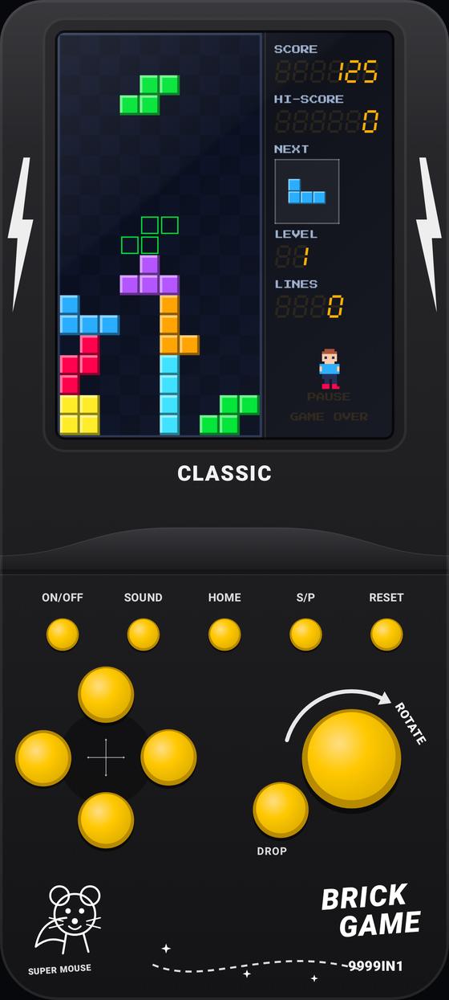
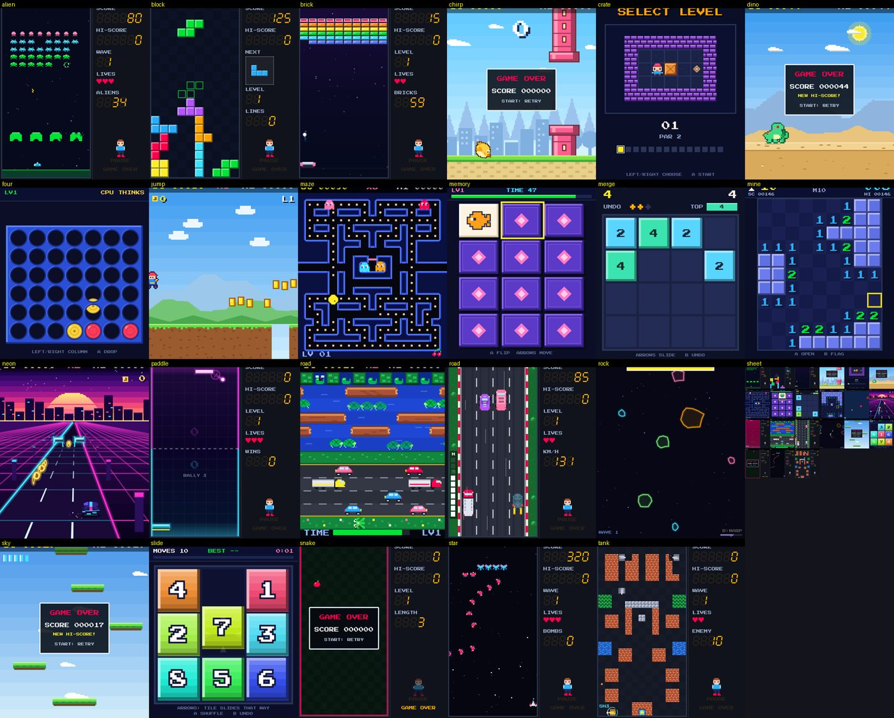
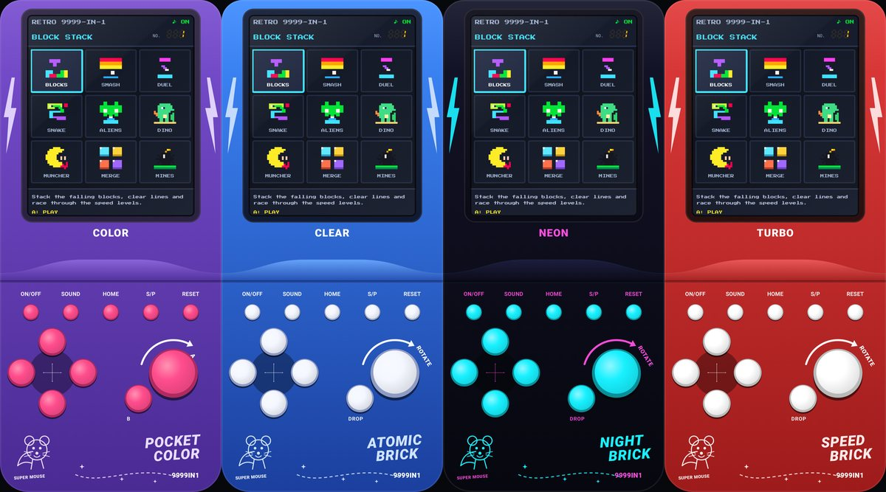

# Retro Console — a colorful 9999‑in‑1 handheld for Android

A pocket game console that looks like the classic **Brick Game** handheld — black shell, yellow keys, lightning
bolts, a **ROTATE** button — but with a **full‑color LCD**, 20+ games, chiptune sound, trophies, and a built‑in
**Game Store** where new games install with **one tap**.

<p align="center">
  
  
</p>

<p align="center"></p>

## Get the app

1. Open the **[latest release](../../releases/latest)** and download **`RetroConsole.apk`**
   (or grab the `RetroConsole-apk` artifact of any [Actions](../../actions/workflows/android.yml) run).
2. Open it on your phone and allow *Install unknown apps* when Android asks.
3. Tap a tile on the console's screen (or use the D‑pad + **A**) and play. Tap **GAME STORE** to download more.

> Android 7.0+ (API 24). Sound, vibration, Bluetooth gamepads, landscape, English / Français / العربية.

## What you get

| | |
|---|---|
| **Console look** | Realistic shell with ON/OFF · SOUND · HOME · S/P · RESET keys, slide‑friendly D‑pad, big ROTATE (A) key and a B key. 5 skins (Classic Black, Purple, Atomic, Neon, Racer). |
| **Screen modes** | Full color · Game Boy green LCD · Brick mono LCD, optional dot‑matrix pixel grid, boot animation, classic 7‑segment side panel (SCORE · HI‑SCORE · NEXT · LEVEL · LIVES) with a running mascot. |
| **Game Store** | One tap to install, update or remove; **Install all**; categories, search, offline cache, SHA‑256 verified downloads, background auto‑update on Wi‑Fi. |
| **Add any game** | From a **file** (.zip or a single .html), a **link**, a **QR code** or `retrogame://install?url=…`. Plain HTML5 games run in *compat mode* (D‑pad/A/B → arrows/Space/X). |
| **Your own games** | **Store → ➕ → "My own game file"** plays NES and Game Boy / Color files you already own, with bundled open-source emulators (files are never provided by the app). See [docs/EMULATORS.md](docs/EMULATORS.md). |
| **Sound & feel** | Synthesized 8‑bit sound effects + music loops, haptics on buttons and in games. |
| **Progress** | Per‑game hi‑scores, **trophies**, play time, **save & resume** (the game pauses and saves when you leave). |
| **Controls** | Touch, Bluetooth/USB gamepads and keyboards (arrows/WASD, Space/Z = A, X = B, Enter = S/P, Select/Esc = Home), left‑handed layout, adjustable key size. |
| **Safe by design** | Games run in an offline sandbox (no network, strict CSP); archives are validated (zip‑slip, size caps, allow‑listed file types). |

## The games

<!-- GAMES:START -->
**Classic pack** (6)

| Game | How to play | Where |
|---|---|---|
| **Block Stack** — Stack the falling blocks, clear lines and race through the speed levels. | D-pad: Move / soft drop; A: Rotate; B: Hard drop | built in |
| **Brick Smash** — Bounce the ball off your paddle and smash rainbow walls. Catch falling power-ups: wide paddle, multi-ball, slow ball and extra lives. | D-pad: Move paddle (left/right); A: Launch ball | built in |
| **Paddle Duel** — Neon paddle duel against the CPU. Every return speeds the ball up, hit it off the edge of your paddle to steer it, and grab orbs to freeze your rival. | D-pad: Move paddle (left/right); A: Smash shot | built in |
| **Road Racer** — Weave through four lanes of traffic at ever-higher speed. Grab coins and fuel cans, pass close for bonus points and fire the nitro when the road opens up. | D-pad: Left/right: change lane. Up: boost. Down: brake; A: Nitro burst | built in |
| **Snake** — Guide a rainbow snake to apples and timed bonus fruit. It speeds up as it grows, walls bite, and later levels turn the edges into portals. | D-pad: Steer; A: Hold for speed boost | built in |
| **Tank Duel** — Defend your headquarters star from waves of enemy tanks. Blast brick walls, grab power-ups and survive as the armour gets heavier. | D-pad: Drive and turn; A: Fire (hold to keep shooting) | built in |

**Arcade pack** (11)

| Game | How to play | Where |
|---|---|---|
| **Alien Blaster** — Hold the line against marching pixel aliens. Hide behind crumbling shields, snipe the bonus UFO and survive ever faster waves. | D-pad: Move cannon; A: Fire (hold) | Game Store |
| **Bomb Maze** — Lay bombs, blast the crates and chain the explosions to trap wandering blobs, chasers and ghosts. Dig up power-ups, find the hidden exit and survive ten ever-trickier mazes. | D-pad: Move; A: Place bomb; B: Detonate remote bombs | Game Store |
| **Coast Run** — A sunny time-attack drive along rolling coast roads. Race the clock, overtake traffic, grab checkpoints and pick your route at every fork on the way to the goal. | D-pad: Left / right steer; A: Gas; B: Brake | Game Store |
| **Hover Rally** — Eight hover-craft, three laps, three tracks. Ride sweeping curves, hills and banked turns, boost with your shield energy and recharge on the glowing strips. Finish in the top four to unlock the next track. | D-pad: Left / right steer; A: Boost (drains energy); B: Airbrake for tight turns | Game Store |
| **Maze Muncher** — Gobble every dot in the neon maze while four ghosts with four different brains hunt you. Grab a power pellet and turn the tables! | D-pad: Steer (turns are queued) | Game Store |
| **Nova Rider** — Fly over a chequered world in a pseudo-3D rail shooter. Dodge rock columns and trees, blast enemy waves and ground turrets, fly through bonus gates and defeat a giant boss at the end of each of three stages. | D-pad: Fly anywhere on screen; A: Rapid laser (auto-aim); B: Bomb (limited) | Game Store |
| **Pocket Pinball** — A full space-themed pinball table in your pocket: pop bumpers, drop targets, a spinner, a ramp, lanes, a ball-holding saucer and multiball. Pull the plunger and keep the silver ball alive. | D-pad: Flippers / hold Down = plunger; A: Left flipper; B: Right flipper | Game Store |
| **Road Hopper** — Hop across a busy road and a wild river to reach the five home bays. Dodge cars, ride the logs and watch out for sinking turtles! | D-pad: Hop (one jump per press) | Game Store |
| **Rock Blaster** — Drift, spin and blast your way through a neon asteroid field. Rocks split, saucers shoot back and the hyperspace jump is your last resort. | D-pad: Left/Right turn, Up thrust; A: Fire (hold); B: Hyperspace jump | Game Store |
| **Scaffold Rush** — Climb an unfinished tower while a mischievous robot rolls tyres down the girders. Jump the hazards, grab the mallet, ride lifts and belts, then pop every rivet to bring the whole structure down. | D-pad: Walk / climb ladders; A: Jump; B: Jump | Game Store |
| **Star Fighter** — Swarms swoop in on curved paths and dive-bomb your fighter. Beware the tractor beam, rescue a captured ship for dual fire and survive the challenge stages. | D-pad: Move ship; A: Fire (hold); B: Smart bomb | Game Store |

**Puzzle pack** (8)

| Game | How to play | Where |
|---|---|---|
| **Capsule Clinic** — Drop two-colour capsules into the bottle and line up four of a colour to wipe out the grinning germs. Clear them all to move on to a tougher bottle. | D-pad: Move / soft drop; A: Rotate; B: Rotate back | Game Store |
| **Crate Pusher** — Push every crate onto a glowing target. Plan ahead: crates can only be pushed, never pulled. 14 hand-made warehouse levels, from easy to brain-melting. | D-pad: Walk & push; A: Restart (hold: level select); B: Undo move | Game Store |
| **Four in a Row** — Drop discs and connect four before the CPU does. The computer gets smarter with every level you beat. | D-pad: Choose column; A: Drop disc | Game Store |
| **Gem Stack** — Triples of shaped gems tumble into a narrow well. Line up three or more of a kind in any direction, even diagonally, and set off glittering chain reactions. | D-pad: Move / soft drop; A: Shuffle gems down; B: Shuffle gems up | Game Store |
| **Memory Match** — Flip the cards and find every pair before the clock runs out. Chain matches for a combo multiplier and clear bigger boards on each level. | D-pad: Move cursor; A: Flip card | Game Store |
| **Merge 2048** — Slide the colourful tiles, merge matching numbers and chase the 2048 tile. Undo charges refill every time you reach a new tile. | D-pad: Slide all tiles; B: Undo (limited) | Game Store |
| **Mine Finder** — Sweep the minefield with the D-pad cursor. Numbers count the neighbouring mines, flags mark the danger. Every cleared board adds more mines. | D-pad: Move cursor; A: Reveal / chord on a number; B: Flag / unflag | Game Store |
| **Slide Puzzle** — Slide the colourful numbered tiles back into order. Starts with 3x3, then 4x4 and 5x5, and every shuffle is guaranteed solvable. | D-pad: Slide tile that way; A: New shuffle; B: Undo move | Game Store |

**Action / Platform pack** (11)

| Game | How to play | Where |
|---|---|---|
| **Chirp Flap** — Flap your little chick through the colourful towers. The gaps shrink, the speed climbs, and coins hide in the gaps. | D-pad: Up flap; A: Flap; B: Flap | Game Store |
| **Dino Dash** — Run through the desert, leap over cacti and boulders, duck under birds. Day turns to night as you speed up. | D-pad: Up jump, Down duck; A: Jump (hold = higher); B: Duck / fast-fall | Game Store |
| **Jump Hero** — A bite-sized platformer: run, jump and throw fireballs through grassland, crystal cave and fire castle. Beat them all and the world loops, harder. | D-pad: Move; A: Jump (hold = higher); B: Run / throw fireball | Game Store |
| **Neon Runner** — Race down a synthwave highway in three lanes. Jump the barriers, slide under the beams, grab neon coins, magnets and shields. | D-pad: Left / right change lane; A: Jump; B: Slide (or dive) | Game Store |
| **Ring Champs** — Climb the boxing ladder against a cast of cartoon fighters. Read each tell, dodge, counter to earn stars, then unleash the super uppercut. | D-pad: Left/Right dodge, Down block, Up super; A: Left jab; B: Right jab | Game Store |
| **Rune Dungeon** — A top-down dungeon adventure. Slash slimes, bats and shielded skeletons, find keys, push blocks onto floor plates, shoot crystal switches with your bow and beat two bosses across two dungeons. | D-pad: Walk / push blocks; A: Sword slash; B: Shoot arrow | Game Store |
| **Sand Palace** — A cinematic palace escape. Run, leap and climb through trap-filled halls, duel the guards with a curved blade and reach every exit before the sand runs out. | D-pad: Walk / crouch / hang at edges; A: Jump / sword strike; B: Hold to run / parry | Game Store |
| **Shadow Blade** — A fast ninja action-platformer. Run across moonlit rooftops, bamboo groves and an iron fortress, slash guards, parry arrows, throw shuriken and beat three bosses with learnable patterns. | D-pad: Run / UP = jump (x2); A: Sword slash; B: Throw shuriken | Game Store |
| **Sky Hopper** — Bounce up from the clouds into outer space. Dodge or blast monsters, grab rockets and springs, never fall. | D-pad: Steer (screen wraps); A: Shoot up; B: Shoot up | Game Store |
| **Spin Runner** — Roll as Orb, a tiny round robot, through three fast zones: windmill fields, a glowing mushroom cavern and a clockwork works. Build speed on slopes, charge-roll, loop the loop and smash the bugs. | D-pad: Left/right run, hold Down to roll or charge; A: Jump (hold = higher); B: Roll (same as Down) | Game Store |
| **Street Brawler** — Fight through city streets, harbour docks and neon rooftops. Chain punches, jump kick, swing a pipe and take down each stage's boss. | D-pad: Walk in 8 directions; A: Punch combo / air kick; B: Jump (A+B = spin attack) | Game Store |
<!-- GAMES:END -->

Built‑in games work offline; Game Store games download on demand and are updated automatically.

## Build it yourself

You need JDK 17 and the Android SDK (platform 35). Everything else is downloaded by Gradle.

```bash
cd android
./gradlew testDebugUnitTest          # installer security tests, console/bridge tests, UI renders → app/build/screenshots
./gradlew assembleDebug              # app/build/outputs/apk/debug/app-debug.apk
./gradlew assembleRelease            # minified; signed with your keystore if RETRO_KEYSTORE* env vars are set, else the debug key
```

**CI** (`.github/workflows`) does the same on every push: unit tests → APKs (artifact) → on `main` a rolling
**`latest` release**. Add the secrets `RETRO_KEYSTORE_B64`, `RETRO_KEYSTORE_PASSWORD`, `RETRO_KEY_ALIAS`,
`RETRO_KEY_PASSWORD` to sign releases with your own key. A second workflow smoke‑tests every game in a headless
browser and checks that `store/` is up to date.

## Make or add a game

Games are tiny HTML5 packages written against a ~1000‑line SDK (`web/sdk/retro-sdk.js`) that provides the LCD, input,
loop, HUD, sound, sprites, particles, saves, trophies and haptics.

```bash
node tools/dev-server.cjs                       # play every game in your browser at http://localhost:8080 (keyboard)
cp -r web/games/_template web/games/store/my-game   # start a game
export NODE_PATH=$(npm root -g)                 # or: cd tools/test && npm install
node tools/test/smoke.cjs my-game               # plays it with random input, checks errors/blank screens/save-resume/CSP
python3 tools/build_store.py                    # packs it into store/ so every phone can download it
```

* **[docs/GAME_SDK.md](docs/GAME_SDK.md)** — manifest, lifecycle, full API, quality bar.
* **[docs/STORE.md](docs/STORE.md)** — publishing, updates, hosting your own store, sharing by QR code.
* **[docs/EMULATORS.md](docs/EMULATORS.md)** — the "import my own game file" emulators (NES, Game Boy / Color).

## How it fits together

```
web/sdk/retro-sdk.js     game SDK (LCD stage, input, audio, HUD, bridge)      ┐ bundled into the APK
web/shell/home.*         the console's menu + boot animation, drawn on the LCD │ (assets/web)
web/games/builtin/*      games that ship inside the APK                        ┘
web/emulators/*          bundled emulator cores + players for the user's own game files (NES, Game Boy)
web/games/store/*  ──tools/build_store.py──▶  store/catalog.json + store/packs/*.zip  ──GitHub raw──▶  Game Store
android/                 Kotlin + Jetpack Compose shell: console UI, WebView "LCD", JS bridge, store, installer,
                         settings, trophies, WorkManager auto‑update
tools/                   dev server, headless smoke tests, store builder, icon/strings generators
```

The LCD is a single locked‑down `WebView`: `WebViewAssetLoader` serves `/sdk`, `/shell`, `/builtin/<id>` from the APK
and `/installed/<id>` from app storage; every other request is blocked and each page gets a strict
Content‑Security‑Policy. The console's keys reach the game as `Retro._n.button(name, down)`; the game talks back
through a small `RetroNative.postMessage` bridge (hi‑scores, trophies, saves, haptics).

## Credits

* Pixel font: **Press Start 2P** © The Press Start 2P Project Authors — SIL Open Font License 1.1
  (`web/sdk/fonts/OFL.txt`).
* Emulators for your own game files: **jsnes** (Apache-2.0) and **binjgb** (MIT) — see `THIRD_PARTY_NOTICES.md`.
* All games, art, sound effects and music loops are original. Game *mechanics* are classics; names and artwork are not
  taken from any commercial title.
